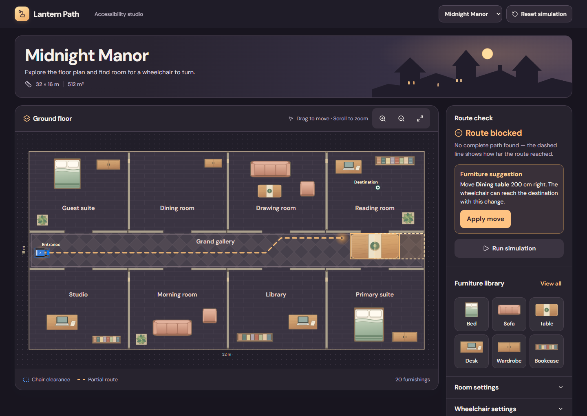

# Lantern Path

Lantern Path is a browser-based floor planner for testing wheelchair turns before moving furniture. Drag a table, change the chair dimensions, or try a suggested move and watch the chair take the route. Built for Kiroween 2026, Frankenstein category.



## Run locally

Use Node.js 24 and npm. From the repository root, run:

```sh
npm ci
npm run dev
```

Open the local URL printed by Vite, usually `http://127.0.0.1:5173`. The planner runs in the browser. No account, API key, or backend is required.

## Try the judge demo

1. Open **Midnight Manor**. Follow the dashed route from the entrance to the stop outside the reading room.
2. Under **Furniture suggestion**, find the dining table on the plan. The dashed rectangle marks its proposed position, 200 cm to the right.
3. Click **Apply move**. When **Route found** appears, click **Run simulation** and watch the chair turn into the reading room.
4. Switch to **Book Fair** to try a tighter corner. Select **Table B** and move it right with the arrow keys. Each press moves the selected item 10 cm. A 40 cm shift opens the route in the default layout.

Reload the page to restore the initial demo. **Reset simulation** resets playback and preserves your furniture edits.

## How the model works

The planner searches positions on an 8 cm grid with eight headings. It tests the padded wheelchair footprint through each translation and rotation. If the route is blocked, it checks up to six nearby movable objects for a single straight slide. A recommendation includes the object, direction, distance, and a position with a verified route. The search runs in a Web Worker so the plan remains interactive.

The result applies to the supplied geometry and chair dimensions. The discrete search can miss a feasible route. Use the model to compare layouts and verify measurements and clearances on site.

## Tests and production build

```sh
npm test
npm run build
npm run preview
```

Vite writes the static site to `dist/`. The tests cover corner turns, collisions during rotation, editable scenes, and whether applying a furniture suggestion opens the route.

## Development with Kiro

The original prototype was called **Make Room**, the name used in the early specs. Its corner-clearance spec records the requirements, design, and test tasks. The corresponding regression test checks a turn whose endpoints both fit but whose rotation clips an obstacle. Other Kiro specs cover the custom room editor and moving the mansion route search into a worker. [Kiro specs](.kiro/specs) · [Corner-clearance tests](test/planner.test.js)

The English submission copy and recording script are available in [the Devpost draft](docs/devpost.md) and [the demo script](docs/demo-script.md).
